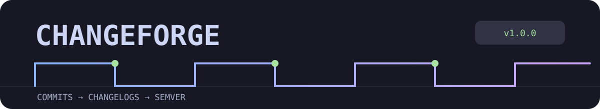

# ChangeForge

<p align="center"></p>

**A zero-dependency Conventional Commits toolkit for changelogs, semantic versioning and local Git hooks.**

ChangeForge runs with Python 3.9+ and the Python standard library. No package installation is required.

## Quick start

```bash
python changeforge.py --help
```

Validate a message:

```bash
echo "feat(api): add pagination" | python changeforge.py lint
python changeforge.py lint --file .git/COMMIT_EDITMSG
```

Generate a changelog from commits since the latest tag:

```bash
python changeforge.py changelog
python changeforge.py changelog --since v1.2.0..HEAD --version 1.3.0
python changeforge.py changelog -o CHANGELOG.md
```

Calculate the next version:

```bash
python changeforge.py bump
python changeforge.py bump --current 1.4.2 --since v1.4.2..HEAD
```

Version rules: breaking change → **major**, `feat` → **minor**, `fix` or `perf` → **patch**. Other commit types do not change the version. If no release tag exists, the baseline is `0.1.0`.

Install a repository-local commit-msg hook:

```bash
python changeforge.py install-hook
```

The hook validates future commit messages. It does not rewrite commits or modify Git history. Use `--force` only if you intend to replace an existing hook.

## Supported commit format

```text
type(scope): description

Optional body.

BREAKING CHANGE: explain the incompatible change
```

Recognized changelog sections include `feat`, `fix`, `perf`, `refactor`, `docs`, `build`, `ci`, and `test`. Unknown types are grouped under Other.

## Notes and limitations

- Changelog generation reads local Git history; it does not push tags or create releases.
- The hook is local to the current clone and is not automatically shared with collaborators.
- Merge commits are excluded.
- Commit messages that do not match Conventional Commits are ignored by changelog generation.
- The tool never executes Dockerfiles or project build scripts.

## Development

```bash
python -m unittest discover -s tests -v
python -m py_compile changeforge.py
```

## License

MIT. See [LICENSE](LICENSE).
